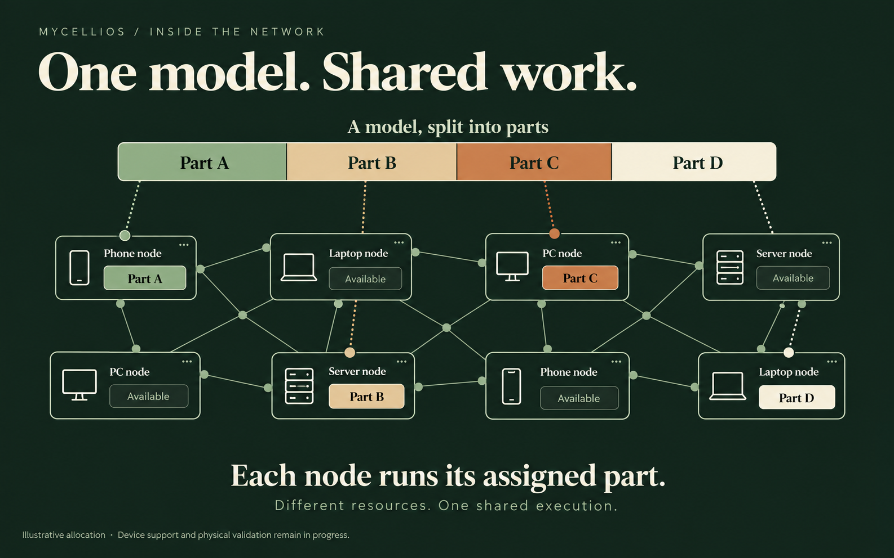

<p align="center">
  
</p>

<p align="center">
  <strong>Open-source AI inference, built around connected devices.</strong><br />
  Phones, laptops, PCs and servers — a network of contributing compute nodes.
</p>

<p align="center">
  <a href="#try-it-locally"><strong>Get started</strong></a> ·
  <a href="docs/ARCHITECTURE.md">Architecture</a> ·
  <a href="docs/STATUS_AND_EVIDENCE.md">Project status</a> ·
  <a href="CONTRIBUTING.md">Contribute</a>
</p>

<p align="center">
  <a href="https://github.com/Mycellios/mycellios/actions/workflows/public-quality.yml"></a>
  <a href="docs/DEVELOPMENT.md"></a>
  <a href="LICENSE"></a>
</p>

## One model. Shared compute.

Mycellios is designed around a network of contributing devices: phones,
laptops, desktop PCs and servers all have a place as compute nodes. Each node
contributes according to its resources and compatible runtime.

Large models can need more memory than one device can provide. The approach
is to divide a supported model into smaller parts and assign each part to a
participating node.

Within the network, a coordinator selects compatible nodes and assigns model
work. Participating nodes execute that work and exchange intermediate results.
Together, they produce one streamed response.

The name comes from **mycelium**: many connected parts working as a network.

> **In development.** Start with the local demo to explore the coordinator and
> API flow. The next validation milestone is a reproducible route across two
> physical computers. See [project status](docs/STATUS_AND_EVIDENCE.md) for the
> current capabilities, measurements and limitations.

## How it fits together

<p>
  
</p>

The illustration focuses on model placement: participating nodes hold their
assigned parts, while other peers remain available. Device support depends on
the hardware and runtime; verified capabilities are listed in
[Status and evidence](docs/STATUS_AND_EVIDENCE.md).

| Part | Its job |
| --- | --- |
| **Compute nodes** | Contribute resources, run assigned model stages and exchange intermediate results. Phones, laptops, PCs and servers share this role in the network vision. |
| **Coordinator** | Plan the model split, prepare the route and supervise its lifecycle. |
| **Execution records** | Capture the details needed to inspect, debug and evaluate a run. |

For the technical design and trust boundaries, read the
[architecture](docs/ARCHITECTURE.md) and [security guide](docs/SECURITY.md).

## Try it locally

**You need:** Node.js 24+ and npm 10.9.8. Python 3.12 and the selected runtime
dependencies are needed for Python model stages; see the
[development guide](docs/DEVELOPMENT.md) for setup details.

```bash
git clone https://github.com/Mycellios/mycellios.git
cd mycellios
npm ci
npm run doctor
npm run demo
```

The demo uses a **mock worker on your computer**. It demonstrates the coordinator
and API flow; it does not run a model across GPUs or measure network performance.

**Ready to work with two computers?** Follow the
[two-host quickstart](docs/TWO_HOST_QUICKSTART.md). It covers prerequisites,
private connectivity, configuration, preflight checks and the native route.

<details>
<summary><strong>Check the example configuration without launching workers</strong></summary>

```bash
npm run preflight:two-host -- --config config/auto-distribute.two-host.example.json --json
```

The checked-in example uses placeholder addresses and should report
`dryRun: true`. A valid configuration is not evidence of a successful physical run.

</details>

## Where the project stands

Mycellios separates implementation from measured results. Automated checks and
single-host runs do not establish performance across physical machines.

The full capability inventory and evidence boundaries live in
[Status and evidence](docs/STATUS_AND_EVIDENCE.md). The
[roadmap](docs/ROADMAP.md) explains the next gates and their acceptance criteria.

### Compute economy & blockchain

The design connects compute usage with contributor accounting and verifiable
execution records. **There is no launched public Mycellios token or active
on-chain contributor settlement.** Current compute credits are internal,
non-monetary, non-transferable and non-withdrawable. Read the
[economic and token status](docs/STATUS_AND_EVIDENCE.md#economic-and-token-status)
for the current scope and future readiness gates.

## Find your next step

| I want to… | Start here |
| --- | --- |
| Understand the design | [Architecture](docs/ARCHITECTURE.md) |
| Check what has been verified | [Status and evidence](docs/STATUS_AND_EVIDENCE.md) |
| Prepare two computers | [Two-host quickstart](docs/TWO_HOST_QUICKSTART.md) |
| Use the HTTP API | [OpenAPI contract](docs/openapi.yaml) |
| Work on the code | [Development](docs/DEVELOPMENT.md) · [Contributing](CONTRIBUTING.md) |
| Report a security issue | [Security policy](SECURITY.md) |
| Browse all documentation | [Documentation map](docs/README.md) |

## Build with us

Contributions to the runtime, documentation and reproducible experiments are
welcome. Read [Contributing](CONTRIBUTING.md) before starting, or
[open an issue](https://github.com/Mycellios/mycellios/issues) to discuss a bug or idea.

Mycellios is licensed under [GPL-3.0-only](LICENSE).
See [third-party notices](THIRD_PARTY.md) for source attribution.
